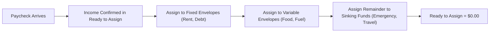
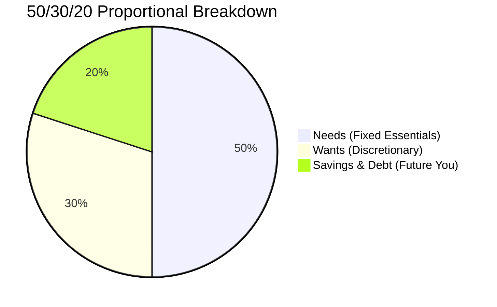
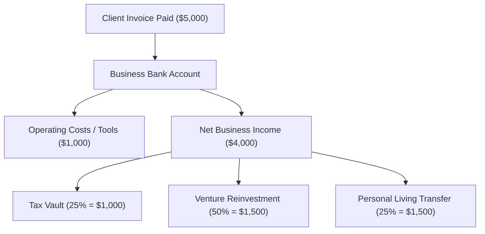

# Finance OS: The Comprehensive User Guide & Operating Manual

Welcome to **Finance OS**, an institutional-grade, multi-tenant personal finance operating system designed around a foundational principle: **Bank balances are never treated as spendable cash. Every unit of currency has a job, transfers between your own accounts never count as expenses, and missing facts always stay UNKNOWN.**

---

## Table of Contents

1. [Interactive Path Selector: Choose Your Option](#1-interactive-path-selector-choose-your-option)
2. [Quick Start & Account Setup](#2-quick-start--account-setup)
3. [Track Deep Dives (Based on Your Chosen Archetype)](#3-track-deep-dives-based-on-your-chosen-archetype)
   - [Option A: Zero-Based Envelope Allocation (ZBB)](#option-a-zero-based-envelope-allocation-zbb)
   - [Option B: The 50/30/20 Proportional Model](#option-b-the-503020-proportional-model)
   - [Option C: Solopreneur & Multi-Business Hub](#option-c-solopreneur--multi-business-hub)
   - [Option D: Debt Payoff Engine (Snowball & Avalanche)](#option-d-debt-payoff-engine-snowball--avalanche)
   - [Option E: Multi-Currency & Global Wealth Builder](#option-e-multi-currency--global-wealth-builder)
4. [Mastering Core Daily Workflows](#4-mastering-core-daily-workflows)
   - [Workflow 1: Single Entry & AI Co-Pilot](#workflow-1-single-entry--ai-co-pilot)
   - [Workflow 2: Universal Bank Statement Ingestion](#workflow-2-universal-bank-statement-ingestion)
   - [Workflow 3: Account Snapshots & True Reconciliation](#workflow-3-account-snapshots--true-reconciliation)
   - [Workflow 4: Conversational Ledger Audit ("Ask Ledger")](#workflow-4-conversational-ledger-audit-ask-ledger)
   - [Workflow 5: Household & Family Collaboration](#workflow-5-household--family-collaboration)
5. [Data Portability, Resetting & Account Lifecycle](#5-data-portability-resetting--account-lifecycle)
6. [Troubleshooting & Best Practices Cheat Sheet](#6-troubleshooting--best-practices-cheat-sheet)

---

## 1. Interactive Path Selector: Choose Your Option

Finance OS adapts to your financial reality rather than forcing you into a single rigid mold. Use this matrix to jump directly to the instructions that match the option(s) you select:

| If Your Financial Goal Is... | Recommended Option | Core Focus & Features | Jump To |
|:---|:---|:---|:---|
| **"I want complete control over every dollar/naira I earn."** | **Option A: Zero-Based Budgeting** | Envelope allocations, Payday Assign flow, month-to-month carryover | [Option A Guide](#option-a-zero-based-envelope-allocation-zbb) |
| **"I want a simple, high-level rule to live below my means."** | **Option B: 50/30/20 Rule** | 50% Needs, 30% Wants, 20% Savings automated split | [Option B Guide](#option-b-the-503020-proportional-model) |
| **"I run a freelance business, agency, or side hustle."** | **Option C: Solopreneur Hub** | Business P&L, Reinvestment vs Personal split, Tax Vaults | [Option C Guide](#option-c-solopreneur--multi-business-hub) |
| **"My urgent priority is eliminating high-interest debt."** | **Option D: Debt Payoff Engine** | Snowball vs Avalanche, APR tracking, Extra payment payoff forecast | [Option D Guide](#option-d-debt-payoff-engine-snowball--avalanche) |
| **"I hold funds across multiple global currencies & banks."** | **Option E: Multi-Currency Wealth** | USD/EUR/GBP/NGN accounts, FX tracking, Cash wallets, Offshore funds | [Option E Guide](#option-e-multi-currency--global-wealth-builder) |

---

## 2. Quick Start & Account Setup

### Step 1: Account Registration & Base Currency
1. Navigate to `/login`.
2. Click **Create Account**.
3. Enter your **Full Name**, **Email**, and a secure **Password**.
4. Select your **Base Currency**:
   - `USD ($)` · `EUR (€)` · `GBP (£)` · `NGN (₦)` · `CAD ($)` · `AUD ($)`
5. Choose your initial archetype template or select **Blank Canvas** if you prefer to build your categories from scratch.
6. Click **Complete Setup**.

> [!NOTE]
> Finance OS operates on strict multi-tenant isolation. Your account starts clean. No demo accounts or third-party institutions are ever pre-seeded into your personal workspace.

### Step 2: Add Your Real Accounts
1. Go to the **Accounts** screen (`/accounts`).
2. Click the `+ Add Account` button in the top right.
3. Provide:
   - **Account Name**: e.g., *Chase Checking*, *Revolut Vault*, *OPay Wallet*, *Physical Cash*.
   - **Institution Name**: The issuing bank or wallet provider.
   - **Account Role**:
     - `Daily Spending`: Primary liquid transactional accounts.
     - `Savings Vault`: Dedicated savings or emergency funds.
     - `Buffer Reserve`: 1-month living expense buffer.
     - `Business`: Dedicated business or client revenue account.
     - `Investment`: Brokerages, crypto wallets, or mutual funds.
   - **Opening Balance**: The verified balance currently in the account.
4. Click **Create Account**. Repeat for each bank, wallet, or credit card you use.

---

## 3. Track Deep Dives (Based on Your Chosen Archetype)

---

### Option A: Zero-Based Envelope Allocation (ZBB)

#### Who It’s For
Anyone who wants zero financial surprises. You allocate every unit of income into specific virtual "envelopes" (Rent, Groceries, Dining Out, Utilities) so that when money leaves your bank, you know exactly which envelope paid for it.

#### Core Principles
1. **Ready to Assign = Confirmed Inflow - Assigned Envelopes**.
2. **Never Spend Bank Balances**: Look at your *Envelope Balance*, not your bank balance, before spending.
3. **Roll With The Punches**: If an envelope is overspent, move funds from another envelope to cover it.

#### Step-by-Step Operating Rhythm

1. **Setting Up Envelopes (`/budget`)**:
   - Click `+ Add Envelope`.
   - Name your envelope (e.g., *Groceries*, *Electricity & Internet*, *Car Maintenance*).
   - Enter your **Planned Monthly Budget**.
   - Select the funding account that typically funds this category.
2. **The Payday Allocation Flow**:
   - When income arrives, log it via Quick Entry or Statement Import.
   - Go to `/budget`. The top indicator displays **Ready to Assign**.
   - Input allocations into each envelope until **Ready to Assign hits 0.00**.
3. **Handling Overspending**:
   - If your *Dining Out* envelope has `$20` remaining and you spend `$50`, the envelope turns **Red (Overbudget by -$30)**.
   - To resolve: Reduce another envelope (e.g., *Entertainment* by `$30`) to balance your budget.

---

### Option B: The 50/30/20 Proportional Model

#### Who It’s For
Busy individuals who want a disciplined, hands-off framework without micromanaging 30 different envelope categories.

#### Core Principles
- **50% Needs**: Housing, utilities, groceries, basic transportation, minimum debt payments.
- **30% Wants**: Restaurants, subscriptions, shopping, vacations, hobbies.
- **20% Future You**: Emergency reserve, investment portfolios, accelerated debt payoff.

#### Step-by-Step Operating Rhythm

1. **Setting Up the 3 Master Envelopes**:
   - In `/budget`, verify you have three master groups:
     - `Group 1: Needs (50%)`
     - `Group 2: Wants (30%)`
     - `Group 3: Savings & Investments (20%)`
2. **Setting the Discretionary Allowance Alert**:
   - Navigate to `/settings`.
   - Set your **Monthly Discretionary Spending Allowance** equal to your 30% Wants total.
   - Finance OS will trigger early warning alerts at `80% (Watch)`, `90% (Warning)`, and `100% (Over Budget)`.
3. **Checking Status**:
   - Review your dashboard (`/`) at the end of each week. The **Category Breakdown** chart instantly visualizes whether your spending ratio is staying within the 50/30/20 boundaries.

---

### Option C: Solopreneur & Multi-Business Hub

#### Who It’s For
Freelancers, agency founders, contractors, and side-hustlers who need to separate business revenue from personal living expenses, reserve taxes automatically, and project business runway.

#### Core Principles
1. **Clean Separation**: Business accounts are tagged with `AccountRole: Business`.
2. **The Automated Split**: Every dollar of business profit is split according to a defined ratio (e.g., 70% Reinvestment / 30% Personal Dividend).
3. **Tax Quarantine**: Estimated taxes are isolated in a tax vault envelope before personal withdrawals occur.

#### Step-by-Step Operating Rhythm

1. **Configuring Your Business Profile (`/business`)**:
   - View your business performance dashboard.
   - Set your **Reinvestment vs. Personal Split**:
     - *Reinvestment %*: Retained in the business for growth, tools, and contractor fees.
     - *Personal Draw %*: Clean dividend transferred to your personal daily account.
2. **Tagging Business Transactions**:
   - In Quick Entry (`/transactions`), add `#business` or click the **Business Expense** checkbox.
   - Example: *"Paid $120 for Railway cloud hosting #business"*
   - Operating expenses are deducted from business P&L without inflating your personal living expenses.
3. **Monitoring Cash Runway Radar**:
   - In `/business`, view the **Runway Projection**:
     $$\text{Runway (Months)} = \frac{\text{Liquid Business Balance}}{\text{Average Monthly Business Burn Rate}}$$
   - If runway drops below 3 months, an alert banner is triggered.

---

### Option D: Debt Payoff Engine (Snowball & Avalanche)

#### Who It’s For
Users committed to becoming debt-free as fast as possible, whether paying off credit cards, student loans, car notes, or personal loans.

#### Core Principles
- **Snowball Strategy**: Pay minimums on all debts, throw all extra cash at the **smallest balance** first. Great for rapid behavioral momentum.
- **Avalanche Strategy**: Pay minimums on all debts, throw all extra cash at the **highest interest rate (APR)** first. Mathematically optimal for minimizing total interest paid.

#### Step-by-Step Operating Rhythm
1. **Listing Your Debts (`/debt`)**:
   - Add each debt liability:
     - Name (e.g., *Amex Gold*, *Student Loan*, *Auto Loan*)
     - Current Outstanding Balance
     - Annual Percentage Rate (APR %)
     - Minimum Monthly Payment
2. **Simulating Accelerated Payoff**:
   - Enter your **Extra Monthly Contribution** (e.g., `$250/month` freed up from your budget).
   - Toggle between **Snowball** and **Avalanche**:
     - The simulator compares the exact **Debt-Free Date** and **Total Interest Saved** under both methods.
3. **Execution in Budget**:
   - Ensure your `/budget` has an envelope named *Extra Debt Payoff*.
   - When extra funds become available, assign them here and execute the payment to the target debt account.

---

### Option E: Multi-Currency & Global Wealth Builder

#### Who It’s For
Global citizens, expats, digital nomads, and multi-currency earners holding assets in USD, EUR, GBP, NGN, or stablecoins.

#### Core Principles
1. **Strict Currency Tagging**: Every account maintains transactions in its native currency code.
2. **No Hallucinated FX**: Balances are never auto-converted using stale exchange rates unless you record an explicit FX conversion event.
3. **Net Worth Transparency**: Holdings are reported in your chosen Base Currency using confirmed valuation points.

#### Step-by-Step Operating Rhythm
1. **Setting Up Multi-Currency Accounts (`/accounts`)**:
   - Add your local account: *Chase Checking (USD)*
   - Add your international account: *Revolut (EUR)* or *Wise (GBP)*
   - Add an offshore savings vault: *Stanbic (NGN)* or *Swissquote (CHF)*
2. **Recording Currency Exchanges (`/transactions`)**:
   - When converting `$1,000 USD` to `€920 EUR`:
     - Record as an **Account Transfer** from *Chase Checking* to *Revolut EUR*.
     - Set Outflow: `$1,000 USD`, Inflow: `€920 EUR`.
     - Because it is classified as an **Internal Transfer**, Finance OS does **not** register an expense, preserving your true net worth.

---

## 4. Mastering Core Daily Workflows

---

### Workflow 1: Single Entry & AI Co-Pilot

Finance OS features an intelligent natural-language parser. You can write your spending naturally without manually filling out five dropdown fields.

#### How to Use
1. Go to `/transactions`.
2. In the **Quick Entry & AI Co-Pilot** box, type:
   - *"Spent $42.50 on groceries at Trader Joe's from Chase"*
   - *"Received $3,200 freelance payment into Business Checking"*
   - *"Moved $500 from Checking to Emergency Vault"*
   - *"Spent 15,000 NGN on fuel from OPay"*
3. Click **✨ Parse with AI Co-Pilot** (or press `Enter`).
4. The Co-Pilot instantly parses:
   - **Date**: Today (or parsed relative date like "yesterday")
   - **Type**: Expense, Income, or Transfer
   - **Amount & Currency**: Parsed accurately with minor units
   - **Account**: Auto-matched to your registered account names
   - **Category & Envelope**: Auto-assigned
5. Click **Confirm & Record** to commit the entry to your immutable ledger.

---

### Workflow 2: Universal Bank Statement Ingestion

Never enter 50 transactions manually at the end of the month. Finance OS can parse exports from any bank or fintech worldwide.

#### Supported Formats
- **Universal Bank CSV**: Any CSV with Date, Description, Amount (or separate Debit/Credit columns).
- **International Banks**: Chase, Bank of America, Wells Fargo, Revolut, Monzo, Wise, Barclays.
- **Fintech & Mobile Wallets**: Apple Card, OPay, Kuda, Stanbic, Access Bank, PayPal CSVs.

#### Step-by-Step Walkthrough
1. Go to `/transactions` and switch to the **Statement Ingestion** tab.
2. Select your **Bank Format** (or leave on `Auto-detect format (Universal)`).
3. Select the **Target Account** (or let the system match it).
4. **Upload your file** (`.csv` or `.txt`) or paste raw CSV text into the box.
5. Click **Parse & Analyze Statement**.
6. **Review the Intelligent Audit**:
   - **Transfers Detected**: Movements between your own registered accounts are flagged as *Transfers* and will never inflate your expense reports.
   - **Duplicates Flagged**: Transactions matching existing ledger dates and amounts are flagged with a warning pill.
7. Click **Deselect Duplicates** to exclude them, then click **Commit to Ledger**.

---

### Workflow 3: Account Snapshots & True Reconciliation

In Finance OS, a bank balance is an **observation**, not an immutable fact. Transactions can be pending, fees may settle late, or cash may be unrecorded.

#### The Reconciliation Principle
$$\text{Ledger Working Balance} + \text{Pending Items} \stackrel{?}{=} \text{Verified Bank Statement Snapshot}$$

#### How to Reconcile
1. Open your real banking app on your phone.
2. Go to `/accounts` in Finance OS.
3. On the account card, click **Reconcile / Snapshot**.
4. Enter the **Current Bank Balance** displayed on your bank's app.
5. The system performs an instant delta check:
   - **Delta = $0.00**: Perfect match! Your ledger is reconciled.
   - **Delta ≠ $0.00**: Finance OS flags the discrepancy and prompts you to check for missing transactions or unposted card fees.

---

### Workflow 4: Conversational Ledger Audit ("Ask Ledger")

Finance OS includes a strictly grounded, non-hallucinating AI financial assistant accessible directly from the interface.

> [!IMPORTANT]
> **The Zero-Hallucination Guarantee**:
> Unlike generic chatbots that invent estimated numbers, the Finance OS Assistant is bound to recorded ledger facts. If a balance or transaction was not entered, the Assistant explicitly replies **UNKNOWN**. It will never invent numbers.

#### Example Queries You Can Ask
- *"How much did I spend on groceries this month?"*
- *"What is the remaining balance in my Rent envelope?"*
- *"How much net revenue has my business generated this quarter?"*
- *"What were my total inter-account transfers last week?"*
- *"Which envelope is closest to overspending?"*

---

### Workflow 5: Household & Family Collaboration

If you share expenses with a partner, spouse, or manage support for family members, Finance OS handles this cleanly without mixing personal boundaries.

1. Navigate to `/household`.
2. **Recurring Support Lines**:
   - Set up scheduled support allowances (e.g., *Parent Support*, *Tuition Stipend*).
   - Enter the agreed monthly stipend and execution date.
3. **Shared Envelopes**:
   - Tag shared household expenses (Rent, Groceries, Home Repairs) so both parties have visibility into envelope consumption without sharing private personal accounts.

---

## 5. Data Portability, Resetting & Account Lifecycle

Your data belongs strictly to you. Finance OS provides complete transparency and zero vendor lock-in.

### 1. Exporting Your Financial Records
- Navigate to `/settings`.
- In the **Export & Data Portability** card, download:
  - **CSV Summary**: Spreadsheets compatible with Excel, Google Sheets, or tax software.
  - **Full JSON Ledger**: A complete, cryptographically consistent backup of every transaction, snapshot, envelope, and account.

### 2. Resetting Workspace (Clean Start)
- If you started with one framework and wish to switch to a different archetype without deleting your login credentials:
  1. Go to `/settings`.
  2. Click **Reset Workspace & Re-Run Setup**.
  3. Confirm the prompt.
  4. All existing accounts, envelopes, and transactions are cleanly purged, and the 3-step setup wizard re-opens immediately.

### 3. Complete Account Purge (GDPR / Privacy Compliance)
- If you wish to delete your entire account permanently:
  1. Go to `/settings`.
  2. Scroll to the **Danger Zone**.
  3. Click **Permanently Delete Account**.
  4. Type `DELETE MY ACCOUNT` into the safety verification prompt.
  5. The backend executes an irreversible cascade deletion: your identity, sessions, bank accounts, ledgers, envelopes, and business records are completely erased from the database.

---

## 6. Troubleshooting & Best Practices Cheat Sheet

| Situation | Recommended Action |
|:---|:---|
| **"I overspent an envelope this month."** | Go to `/budget`. Click on an envelope that has surplus cash and reassign the difference to the overspent envelope. Your net zero-balance is restored. |
| **"A transfer between my banks showed up as an expense."** | Go to `/transactions`, locate the entry, and change its type from `Expense` to `Transfer`. Select the Destination Account. It will immediately be excluded from expenses. |
| **"My bank statement CSV has weird column headers."** | In the Statement Ingestion tab, select `Universal Bank CSV`. Finance OS dynamically matches common header synonyms (*Date, Trans Date, Narration, Description, Memo, Amount, Debit, Credit*). |
| **"My account balance on the screen doesn't match my banking app."** | Click **Snapshot / Reconcile** on `/accounts`. Enter the statement balance from your bank. Finance OS will calculate the exact variance so you can trace the missing item. |
| **"I want to change my primary currency."** | Reset your workspace from `/settings`, select your new base currency (USD, EUR, GBP, NGN, etc.), and complete the 3-step setup. |
| **"How do I log offline when I have no internet?"** | The web app is a Progressive Web App (PWA). If you lose connection, an **Offline Mode** banner appears. You can continue recording transactions; they queue locally and automatically synchronize as soon as connection is restored. |

---

*Finance OS — Institutional discipline for personal wealth.*
